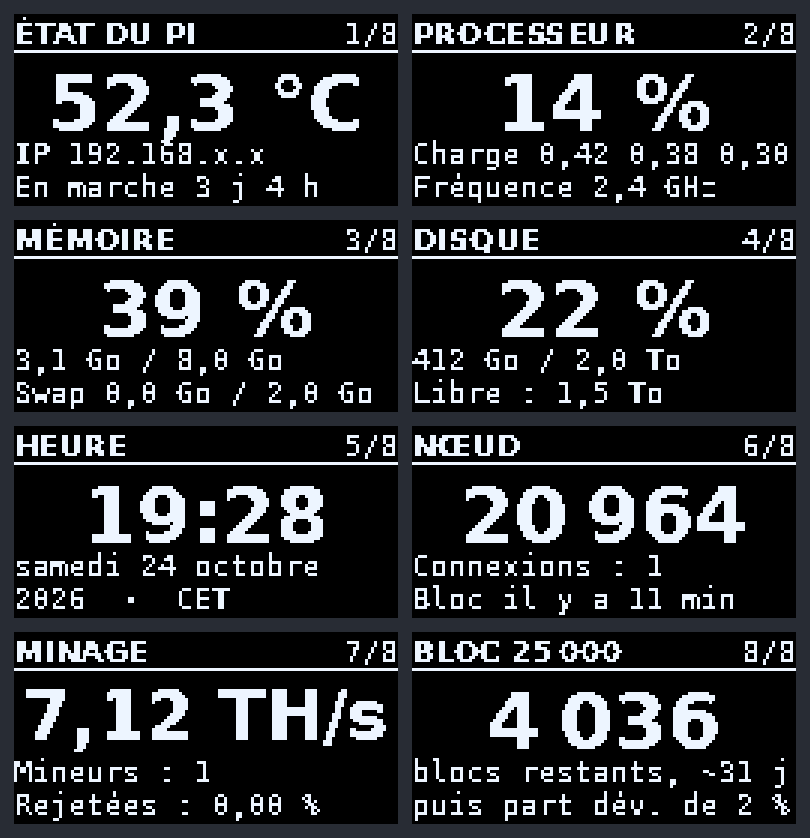

# Écran OLED du boîtier Argon ONE V5 sous Umbrel

Le petit écran OLED du boîtier **Argon ONE V5** (module OLED, 0,96", 128×64) marche avec le script d'Argon sous Raspberry Pi OS /
Debian, mais **pas sous Umbrel** : ce script doit modifier le système (activer l'I2C dans le fichier de démarrage), et umbrelOS ne
le laisse pas faire.

Ce programme **ne modifie rien** dans le système. Il parle à l'écran lui-même, par le bus I2C du noyau s'il existe
(`/dev/i2c-1`, déjà actif sur umbrelOS dans les cas testés), sinon directement avec les deux broches du Pi (GPIO 2 = SDA,
GPIO 3 = SCL). Il tourne dans un conteneur Docker : pour l'enlever, on supprime le conteneur, et une mise à jour d'Umbrel ne
l'efface pas.



*(Aperçu généré par le programme lui-même : `python3 ecran.py apercu`.)*

## Pages disponibles

L'écran d'origine affiche la température du processeur, la durée de marche et l'adresse IP. Ces trois infos sont sur la page
`etat`. Les autres pages sont en plus, à choisir avec la variable `PAGES` (une page toutes les 6 secondes).

| Page | Contenu | Par défaut |
|---|---|---|
| `etat` | température, adresse IP locale, durée de marche | oui |
| `cpu` | utilisation du processeur, charge, fréquence | oui |
| `memoire` | mémoire utilisée, swap | oui |
| `disque` | place utilisée et libre | oui |
| `horloge` | heure et date | oui |
| `noeud` | nœud Bitcoin Core (ou dérivé), via son RPC : hauteur, connexions, âge du dernier bloc | non |
| `minage` | pool [ckpool](https://bitbucket.org/ckolivas/ckpool) : hashrate, mineurs, parts rejetées | non |
| `compte` | compte à rebours jusqu'à un bloc (`BLOC_CIBLE`) | non |

> Le programme n'écrit **jamais** à l'adresse `0x1A` : c'est celle du microcontrôleur du boîtier (ventilateur et alimentation).

## Installation (sur le Pi, en SSH)

```bash
cd /home/umbrel
git clone --depth 1 https://github.com/bryancarterdouglas/argon-one-v5-oled-ecran-umbrel.git
cd argon-one-v5-oled-ecran-umbrel
sudo docker build -t argon-oled .
```

**1. Diagnostic** (ne fait que regarder, n'écrit rien sur l'écran). Le mode `--privileged` n'est utilisé que pour cet essai :

```bash
sudo docker run --rm --privileged --network host argon-oled python3 /app/ecran.py diag
```

Cherche la ligne `=> ECRAN TROUVE`. Sous Umbrel, le bus I2C du noyau est en général déjà actif (`/dev/i2c-1`) : c'est le chemin
préféré. Les broches GPIO (`/dev/gpiochip0` sur Pi 5 récents) ne servent que de secours.

**2. Mire de test** (15 secondes) : doit afficher « ARGON » et « écran OK » avec un triangle en haut à droite.

```bash
sudo docker run --rm --network host --device /dev/i2c-1 --device /dev/gpiochip0 argon-oled python3 /app/ecran.py test
```

**3. Lancement permanent** (adapte `/dev/i2c-1` et `/dev/gpiochip0` à ce que le diagnostic a affiché ; `TZ` donne le fuseau
horaire de la page `horloge`) :

```bash
sudo docker run -d --name argon-oled --restart unless-stopped --network host \
  --device /dev/i2c-1 --device /dev/gpiochip0 \
  -e TZ=Europe/Paris \
  argon-oled
```

## Ajouter les pages d'un nœud Bitcoin Core et de ckpool

Les pages `noeud`, `minage` et `compte` lisent le RPC du nœud (identifiant + mot de passe dans un fichier) et le journal de ckpool.
Exemple pour un nœud dont le RPC écoute sur le port 9332 :

```bash
sudo docker run -d --name argon-oled --restart unless-stopped --network host \
  --device /dev/i2c-1 --device /dev/gpiochip0 \
  -e TZ=Europe/Paris \
  -e PAGES=noeud,minage,etat,cpu,memoire,disque,horloge \
  -e NOM_NOEUD=MONNOEUD -e RPC=http://127.0.0.1:9332 -e RPCUSER=monutilisateur \
  -e PASSFILE=/run/secrets/rpc -e LOGS=/ckpool/logs \
  -v /chemin/vers/rpcpass.txt:/run/secrets/rpc:ro \
  -v /chemin/vers/ckpool/logs:/ckpool/logs:ro \
  argon-oled
```

Le fichier de mot de passe est monté en lecture seule : le programme ne fait que lire (`getblockchaininfo`, `getnetworkinfo`).
Ne jamais ouvrir le RPC du nœud à Internet.

## Réglages (options `-e NOM=valeur` de `docker run`)

| Option | Effet | Défaut |
|---|---|---|
| `PAGES=etat,cpu` | pages affichées, dans cet ordre | `etat,cpu,memoire,disque,horloge` |
| `TZ=Europe/Paris` | fuseau horaire de la page `horloge` | UTC |
| `RETOURNER=1` | image à l'envers : on la retourne | non |
| `PUCE=sh1106` | image décalée de 2 points ou bande parasite : circuit SH1106 | `ssd1306` |
| `ADRESSE=0x3D` | adresse I2C de l'écran | `0x3C` |
| `CONTRASTE=40` | luminosité de 0 à 255 (plus bas = l'écran dure plus longtemps) | 64 |
| `PAGE_SECONDES=8` | durée de chaque page | 6 |
| `DISQUE=/hote` | dossier dont on mesure la place (utile si on y monte un dossier de l'hôte) | `/` |
| `GPIOCHIP=/dev/gpiochip0` | puce GPIO à utiliser | trouvée toute seule |
| `RPC`, `RPCUSER`, `PASSFILE` | RPC du nœud (pages `noeud` et `compte`) | `http://127.0.0.1:8332`, `bitcoin`, `/run/secrets/rpc` |
| `NOM_NOEUD=MONNOEUD` | titre de la page `noeud` | `NŒUD` |
| `LOGS=/ckpool/logs` | dossier des journaux de ckpool (page `minage`) | `/ckpool/logs` |
| `BLOC_CIBLE=25000` | active la page `compte` : blocs restants jusqu'à ce bloc | 0 (désactivée) |
| `BLOC_CIBLE_TEXTE="mon texte"` | ligne de texte sous le compte à rebours (21 caractères) | vide |

## Mettre à jour

```bash
cd /home/umbrel/argon-one-v5-oled-ecran-umbrel && git pull && sudo docker build -t argon-oled .
sudo docker rm -f argon-oled     # puis relancer la même commande « docker run » qu'à l'installation
```

## Enlever

```bash
sudo docker rm -f argon-oled
```

## Tests (sans matériel)

`python3 test_ecran.py` vérifie avec un faux écran que l'image envoyée est relue à l'identique (SSD1306 et SH1106), que les
pages se dessinent dans tous les cas (mesures impossibles, nœud absent, valeurs extrêmes), et avec de fausses broches que les
octets I2C sont corrects.

## Si l'écran reste noir

1. Lance le diagnostic ci-dessus et envoie sa sortie.
2. Image décalée ou parasitée : essaie `-e PUCE=sh1106`. Image à l'envers : `-e RETOURNER=1`.
3. `sudo docker logs --tail 20 argon-oled` montre les erreurs éventuelles.

## Licence

MIT : tout le monde peut utiliser, copier et modifier ce programme librement (voir `LICENSE`).
